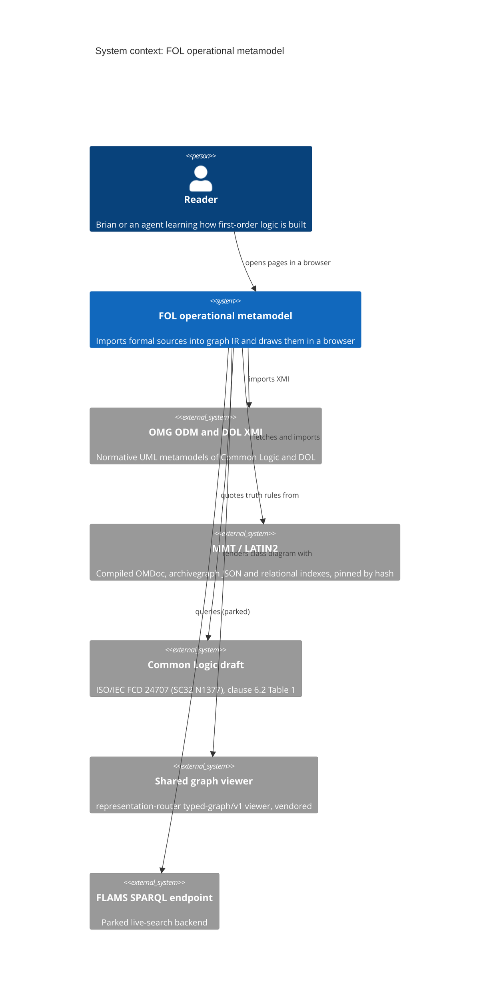
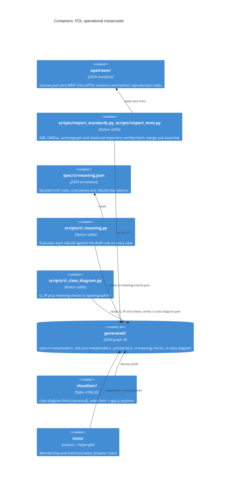

# FOL Operational Metamodel: system model

One page (small repository). The checked trace of rules, owners, tests and
decisions is [trace.yaml](trace.yaml) beside this file. Reviewed against the
source at the commit that adds this file.

## 1. Goals

What the repository is for, its thesis and its non-goals: [GOAL.md](../architecture/GOAL.md).
Questions this page should answer: where does each element of the class diagram
come from; which program writes each generated file; which parts are project
annotation rather than upstream fact; and what a check can observe if it all works.

## 3. Context and scope

Inside: the importers and converters under `scripts/`, the generated graph files
under `generated/`, the marked annotation in `spec/cl-meaning.json`, and the
static pages under `visualizer/`. Outside: the upstream sources (fetched or read
from a local copy, never edited here), the shared graph viewer (vendored, pinned),
and the parked FLAMS SPARQL endpoint.

## 5. Building blocks

Stored state (all files, no database or service):

| Entity | File | Written by |
|---|---|---|
| ENT-STANDARD-IR: standards metamodel graph | `generated/odm-cl-metamodel-ir.json`, `generated/dol-oms-metamodel-ir.json` | `scripts/import_standards.py` |
| ENT-MMT-IR: formal-corpus graph | `generated/pinned-fol-ir.json` (default explorer data), `generated/mmt-ir.json` | `scripts/import_mmt.py` |
| ENT-MEANING: truth-rule annotation | `spec/cl-meaning.json` | hand-edited, marked annotation |
| ENT-MEANING-CHECKS: computed tables and rebuild verdicts | `generated/cl-meaning-checks.json` | `scripts/cl_meaning.py` |
| ENT-CLASS-DIAGRAM: typed-graph/v1 diagram | `generated/cl-class-diagram.json` | `scripts/cl_class_diagram.py` |

Legacy comparison fixture, not authority: `spec/fol.json`, `schema/fol.tql`,
`examples/abc.json` (exercised by `tests/test_model.py`).

## 6. Runtime

Every process is a command a person or agent runs; nothing runs on a schedule.

- **PROC-IMPORT-STANDARDS.** `python3 scripts/import_standards.py odm-cl|dol`
  reads the XMI (`scripts/import_standards.py:207` for ODM CL), extracts one UML
  package with `extract_package` (`scripts/import_standards.py:61`), and writes the
  IR in `write_ir` (`scripts/import_standards.py:183`). Enforces
  RULE-STANDARDS-VERBATIM.
- **PROC-IMPORT-MMT.** `python3 scripts/import_mmt.py fetch` downloads a pinned
  artifact and refuses it on a SHA-256 or Git blob mismatch (`fetch`,
  `scripts/import_mmt.py:759`, checks at 767 and 771); `omdoc`, `archivegraph`,
  `relational`, `merge` and `assemble` (`extract_omdoc` at 86, `merge_irs` at 499,
  `assemble_archive` at 624) normalise explicit structure, and `write_ir` writes
  the IR (`scripts/import_mmt.py:779`). Enforces RULE-MMT-PINNED and
  RULE-MMT-EXPLICIT-ONLY.
- **PROC-CHECK-MEANING.** `python3 scripts/cl_meaning.py` evaluates each rebuild
  against the draft's rule on every case in `check` (`scripts/cl_meaning.py:92`),
  refuses a rebuild that uses a non-core operation, and writes
  `generated/cl-meaning-checks.json` (`scripts/cl_meaning.py:146`). Enforces
  RULE-MEANING-CHECKED.
- **PROC-BUILD-DIAGRAM.** `python3 scripts/cl_class_diagram.py` builds the
  typed-graph/v1 diagram from the CL IR, the annotation and the checks in `build`
  (`scripts/cl_class_diagram.py:38`), marking each meaning record
  `annotation: true` (line 93), and writes `generated/cl-class-diagram.json`
  (`scripts/cl_class_diagram.py:148`). Enforces RULE-DIAGRAM-GENERATED and
  RULE-ANNOTATION-MARKED.
- **PROC-VIEW.** The browser pages only read: `visualizer/class-diagram.html:87`
  fetches the diagram JSON; `visualizer/app.js:292` fetches the selected IR file
  (or queries FLAMS when a focus and endpoint are given, parked). Writes nothing.

## 8. Cross-cutting concepts

- **Graph IR.** Every importer emits the same shape: `nodes` and `edges` with
  stable ids derived from the upstream URI and element id, plus `format`,
  `source` (URI and hash) and a `scope` line stating what was not inferred. Merges join by MMT URI and never invent
  relations.
- **Annotation marking.** Project additions live only in `spec/cl-meaning.json`
  and carry `annotation: true` plus a citation on the diagram; the bridge policy
  in `docs/standards-metamodel.md` and [Decision 0001](../decisions/0001-standards-are-the-authority.md)
  govern this.
- **Membership, not counts.** Tests compare generated output with the upstream
  input by which items are present (DESIGN.md "Extending").

Views (each a projection of the model):

| View | Shows | Hides |
|---|---|---|
| `visualizer/class-diagram.html` (canonical) | ENT-CLASS-DIAGRAM: every CL class and generalization; properties, associations and meaning on click | DOL and MMT layers |
| `visualizer/index.html` explorer (candidate) | ENT-MMT-IR or any IR file via `?data=`; parked FLAMS focus mode | meaning annotation |
| `docs/where-we-are.html` | status and phases, a hand-checked copy of the generalization tree | live data (static page) |

## 10. Quality

Expected observable patterns, each with where it is observable:

- Rebuilding the class diagram from the checked-in IR, annotation and checks yields
  the same JSON content as the checked-in `generated/cl-class-diagram.json`
  (`tests/test_class_diagram.py::test_checked_in_diagram_matches_a_fresh_generation`).
- The set of lines on the diagram equals the set of generalizations in the CL IR,
  no more and no fewer (`tests/test_class_diagram.py::test_diagram_draws_every_generalization_and_no_other_line`).
- Every rebuilt connective or quantifier reports zero counterexamples, and a
  deliberately wrong rebuild reports at least one
  (`tests/test_cl_meaning.py::test_checker_catches_a_wrong_rebuild`).
- On the served page, `UniversalQuantification` is drawn below
  `QuantifiedSentence`, and every visible control shows a tooltip on hover
  (`tests/e2e/class_diagram_e2e.mjs`, `RESULT passed=N failed=0`).
- `generated/pinned-fol-ir.json` records the SHA-256 of the pinned upstream FOL OMDoc
  and contains exactly its constants (`prop`, `and`, `forall`, `exists` and the rest)
  (`tests/test_model.py::test_pinned_real_fol_snapshot_matches_upstream_artifact`).
